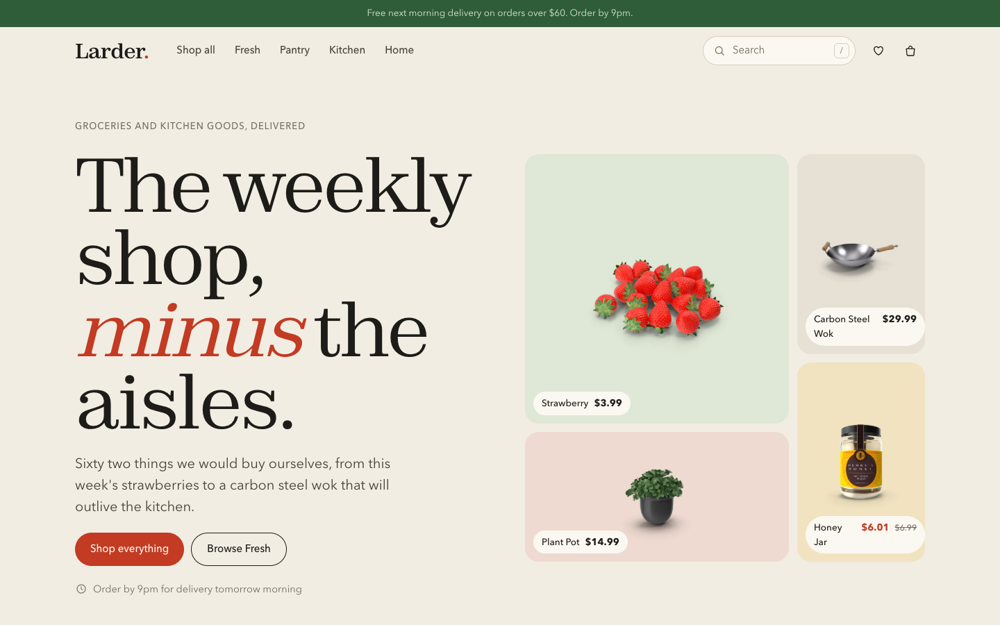
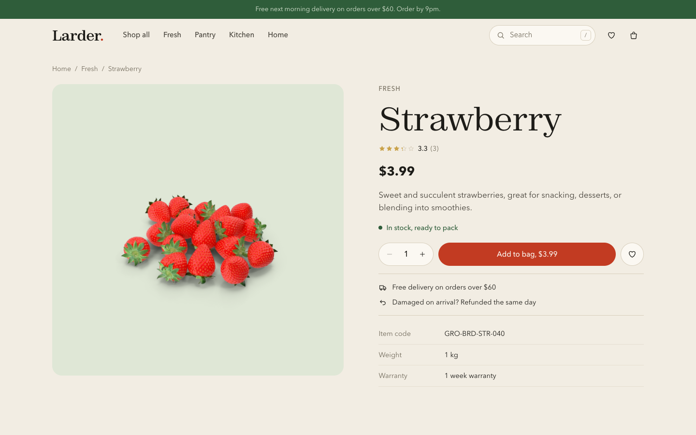
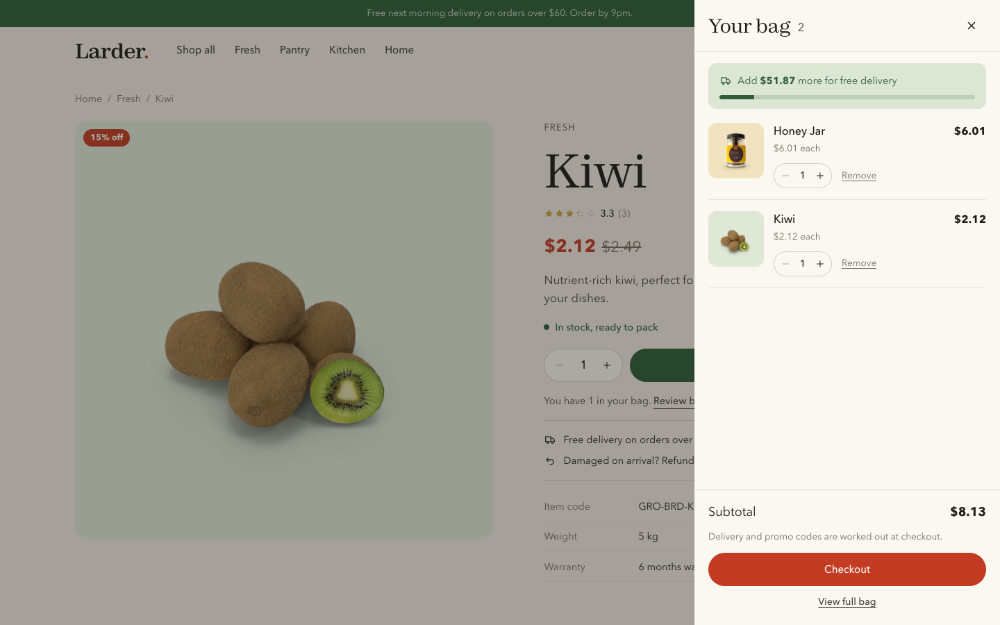
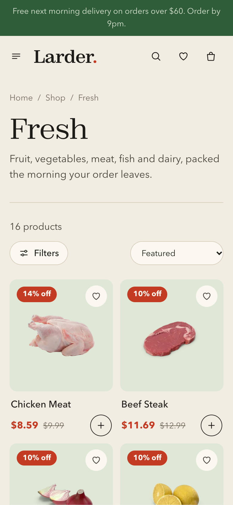

# Larder

A grocery and kitchen goods store front built with React 19, React Router and Vite.
Browse four aisles, search the catalog, fill a bag, apply a promo code, pick a delivery
day and place an order. Everything runs in the browser, so the demo works end to end
with no backend and no payment details.

**Live demo:** https://kushal721.github.io/Ecommerce/



## What works

| Area | Details |
| --- | --- |
| Catalog | 62 real products across Fresh, Pantry, Kitchen and Home, with photos, ratings and reviews |
| Search | Press `/` or `Ctrl K` anywhere. Live results, arrow key navigation, Enter to open |
| Shop | Filter by aisle, price ceiling, stock and rating. Five sort orders. Filters live in the URL, so any view can be shared |
| Product page | Image gallery, quantity, add to bag, save for later, specs, reviews and related items |
| Bag | Slide out drawer and a full page view, quantity steppers, free delivery progress |
| Checkout | Validated address form, next six delivery days, standard or same day delivery, promo codes |
| Orders | Confirmation page and order history, kept in `localStorage` |
| Saved | Heart any product to keep it on the Saved page |

Promo codes to try: `FIRST20` ($20 off orders of $60 or more) and `LARDER10` (10% off).

<p>
  
  
</p>



## Design

- **Type:** Zodiak for display and Satoshi for text, both from Fontshare.
- **Colour:** warm paper background, ink text, one tomato red accent and a leaf green for
  delivery and stock. Each aisle has its own quiet tint behind the product cutouts.
- **Icons:** a small hand drawn SVG set in `src/components/Icon.jsx`, styled after Notion's
  interface icons. No icon library is bundled.
- **Motion:** short entrance and scroll reveals, a small press on buttons, drawers that
  slide. All of it switches off under `prefers-reduced-motion`.
- **Accessibility:** skip link, visible focus rings, focus trapping in drawers and search,
  labelled controls, and keyboard support throughout.

## Run it locally

```bash
cd ecommerce-frontend
npm install
npm run dev        # http://localhost:5173
npm test           # unit tests for cart, pricing, search and checkout
npm run build      # production build in dist/
```

Node 20 or newer is required.

## Project layout

```
ecommerce-frontend/
  scripts/snapshot-products.mjs   refreshes the product data from DummyJSON
  src/
    components/   header, search, bag drawer, product card, footer and shared parts
    pages/        Home, Shop, Product, Cart, Checkout, Order, Orders, Saved, NotFound
    lib/          catalog queries, checkout maths, hooks, money formatting
    store/        cart, saved items and orders (useReducer + localStorage)
    styles/       design tokens and page styles in plain CSS
    data/         products.json, a trimmed snapshot of the catalog
```

## Product data

Product details and photos come from [DummyJSON](https://dummyjson.com/docs/products),
a free mock data service. The catalog is stored in `src/data/products.json` so the store
does not call the API at runtime. Photos are still loaded from `cdn.dummyjson.com`.
Ratings are recalculated from each product's reviews, because the source data's rating
field does not match them. Run `npm run snapshot` to refresh the file.

Some product photos show real brand packaging. They are part of the mock data set, and
this project is not affiliated with those brands.

## Deployment

Every push to `main` runs the tests, builds the site and publishes it to GitHub Pages
through `.github/workflows/deploy.yml`.

## License

[MIT](LICENSE)
